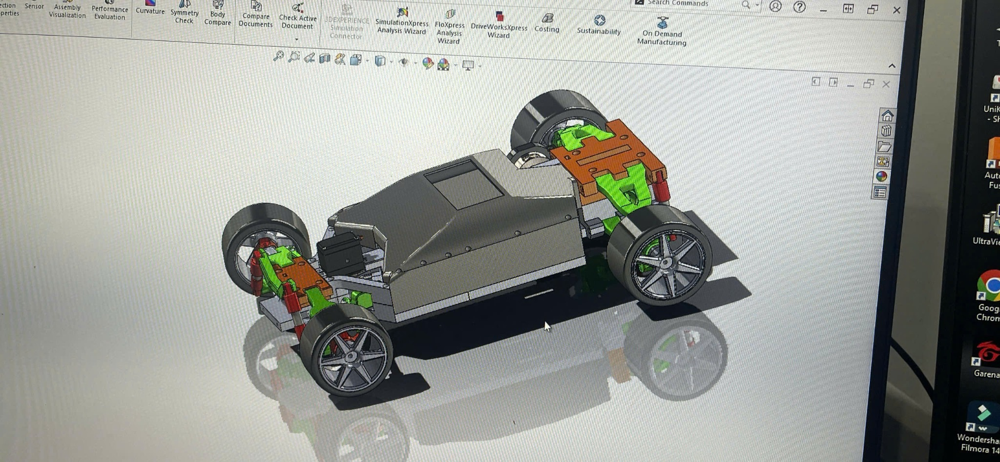
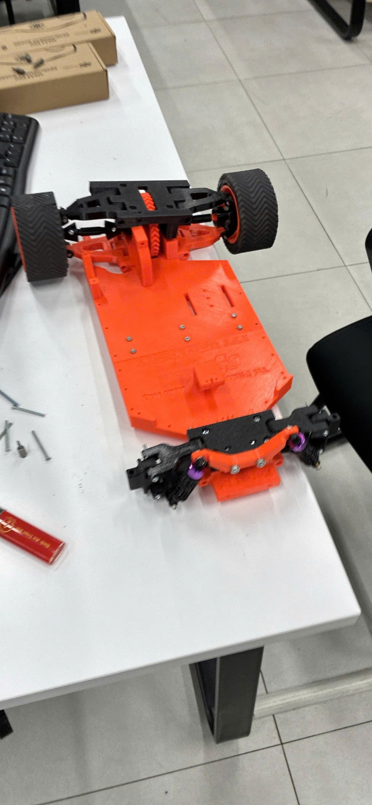
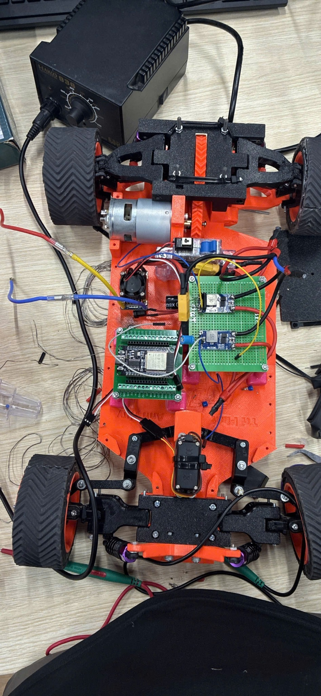
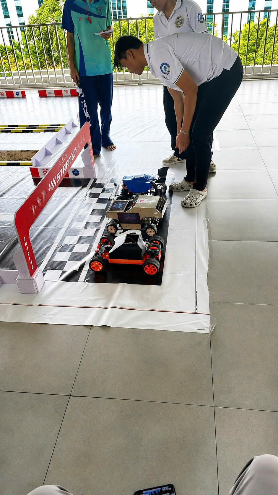
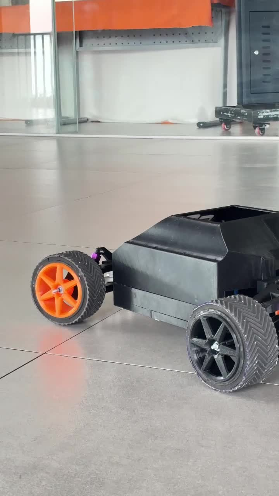

# 3D-Printed RC Racing Car




An ESP32-S3 radio-controlled racing car designed in SolidWorks and built with 3D-printed parts.

## 30-second overview

| Question | Answer |
| --- | --- |
| What did I build? | A complete RC racing prototype: mechanical design, printed structure, electronics, control firmware, and track testing. |
| Why is it notable? | The car received a **Consolation Prize at F-Racing, FPT University**. |
| What does this repo prove? | CAD-to-hardware execution, electromechanical integration, embedded control, iterative fabrication, and competition delivery. |
| Best evidence | [Driving video](assets/videos/driving-demo.mp4), competition photos, firmware, and the downloadable CAD/print release. |

## My contribution

- Developed and iterated the vehicle's mechanical concept and 3D-printed structure.
- Integrated the ESP32-S3, PS2-compatible receiver, ESC, steering servo, gyro, battery, and wiring.
- Prepared the control firmware with throttle ramping, steering input, braking, and a test-limit throttle cap.
- Assembled and tested the physical prototype, then documented the result for reproducibility.
- Participated in F-Racing and delivered a working competition vehicle.

<details>
<summary><strong>Tóm tắt tiếng Việt</strong></summary>

Xe đua RC dùng ESP32-S3, thiết kế cơ khí trên SolidWorks và chế tạo bằng in 3D. Dự án thể hiện toàn bộ quá trình từ CAD, in mẫu, lắp điện, lập trình điều khiển đến chạy thử và thi đấu F-Racing tại FPT University.

</details>

## Achievement

**Consolation Prize — F-Racing competition organized by FPT University.**

## Project overview

This repository follows the prototype from CAD design through printing, assembly, electronics integration, firmware, and driving tests.

| Area | Implementation |
| --- | --- |
| Mechanical design | SolidWorks chassis, body, wheels, steering, and suspension |
| Fabrication | PETG/PETG-CF 3D-print profiles plus STL models |
| Controller | ESP32-S3 with a PS2-compatible receiver |
| Steering | MG996R servo through an RX-7D gyro |
| Throttle | Bidirectional RC ESC with ramping and L2 braking |

## Engineering decisions

- **Modular printed construction:** allowed damaged or revised parts to be replaced without rebuilding the whole car.
- **Throttle ramping and 40% test cap:** reduced drivetrain shock during early validation.
- **Separate steering gyro path:** supported stable steering while keeping ESP32-S3 responsible for command handling.
- **Release-based CAD delivery:** keeps the full STL/3MF package downloadable without bloating normal source browsing.

## Gallery

| CAD model | Printed chassis |
| --- | --- |
|  |  |

| Mechanical assembly | Electronics integration |
| --- | --- |
|  |  |

| Competition | Start line |
| --- | --- |
|  |  |

## Driving demonstration

[](assets/videos/driving-demo.mp4)

[Watch the MP4 driving demo](assets/videos/driving-demo.mp4)

## Firmware

The Arduino sketch is in [`firmware/rc_car_esp32s3/rc_car_esp32s3.ino`](firmware/rc_car_esp32s3/rc_car_esp32s3.ino).

Required Arduino libraries:

- `PS2X_lib`
- `ESP32Servo`

Key pin assignments:

| Function | ESP32-S3 GPIO |
| --- | --- |
| ESC signal | 4 |
| Steering/gyro input | 6 |
| PS2 clock | 10 |
| PS2 command | 11 |
| PS2 data | 12 |
| PS2 attention/select | 13 |

Read the wiring and power warnings in the sketch before connecting hardware.

## CAD and printable files

[Download the complete CAD/3D-print package from Release v1.0.0](https://github.com/huyntriphat01-star/3d-printed-rc-car/releases/download/v1.0.0/RC.CAR.zip). It contains:

- Shark-fin body detail
- RC car body
- Body cover
- 25% infill PETG print project
- 75% infill PETG/PETG-CF print projects

The original SolidWorks source assembly was not present in the supplied archive. The screenshots document that design.

## Repository structure

```text
.
├── assets/
│   ├── images/
│   └── videos/
├── GitHub Release v1.0.0  # Complete STL/3MF package
└── firmware/
    └── rc_car_esp32s3/
```

## Skills demonstrated

`SolidWorks` · `FDM 3D printing` · `ESP32-S3` · `Arduino/C++` · `RC electronics` · `servo/ESC control` · `rapid prototyping` · `system integration` · `technical documentation`

## Notes

- Firmware preserves the supplied test limits, including 40% maximum throttle.
- Test steering direction, ESC neutral, braking, and shared ground with the wheels raised first.

## License

- Firmware and source code: [MIT License](LICENSE).
- CAD, STL, and 3MF design files: [Creative Commons Attribution 4.0 International](LICENSE-CAD.md).
- Photos and videos remain © Huynh Tri Phat. Reuse requires permission.
