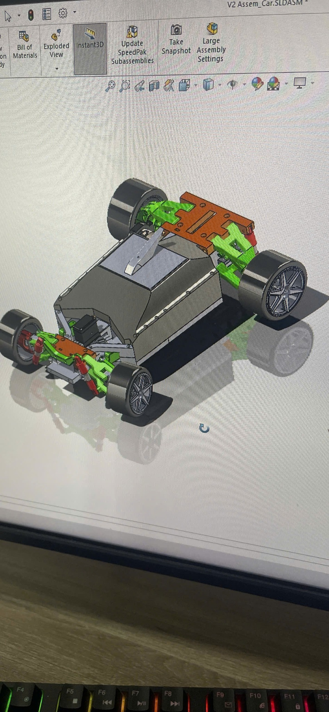
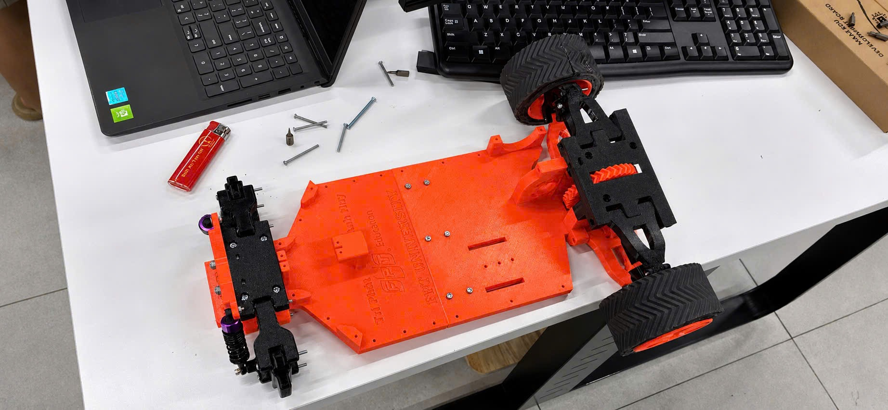
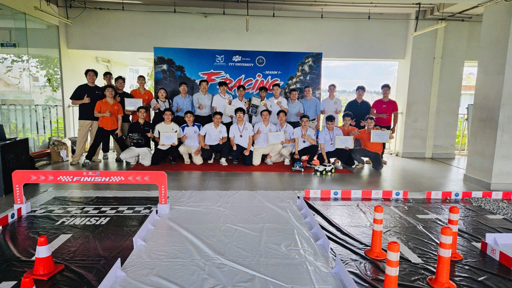

# 3D-Printed RC Racing Car


An ESP32-S3 radio-controlled racing car designed in SolidWorks and built with 3D-printed parts.

## Achievement

**Consolation Prize — F-Racing competition organized by FPT University.**

## Project overview

This repository follows the prototype from CAD design through printing, assembly, electronics integration, firmware, and driving tests.

| Area | Implementation |
| --- | --- |
| Mechanical design | SolidWorks chassis, body, wheels, steering, and suspension |
| Fabrication | PETG/PETG-CF 3D-print profiles plus STL models |
| Controller | ESP32-S3 with a PS2-compatible receiver |
| Steering | MG996R servo through an RX-7D gyro |
| Throttle | Bidirectional RC ESC with ramping and L2 braking |

## Gallery

| CAD model | Printed chassis |
| --- | --- |
|  |  |

| Mechanical assembly | Electronics integration |
| --- | --- |
|  |  |

| Competition | Start line |
| --- | --- |
|  |  |

## Driving demonstration

[](assets/videos/driving-demo.mp4)

[Watch the MP4 driving demo](assets/videos/driving-demo.mp4)

## Firmware

The Arduino sketch is in [`firmware/rc_car_esp32s3/rc_car_esp32s3.ino`](firmware/rc_car_esp32s3/rc_car_esp32s3.ino).

Required Arduino libraries:

- `PS2X_lib`
- `ESP32Servo`

Key pin assignments:

| Function | ESP32-S3 GPIO |
| --- | --- |
| ESC signal | 4 |
| Steering/gyro input | 6 |
| PS2 clock | 10 |
| PS2 command | 11 |
| PS2 data | 12 |
| PS2 attention/select | 13 |

Read the wiring and power warnings in the sketch before connecting hardware.

## CAD and printable files

[Download the complete CAD/3D-print package from Release v1.0.0](https://github.com/huyntriphat01-star/3d-printed-rc-car/releases/download/v1.0.0/RC.CAR.zip). It contains:

- Shark-fin body detail
- RC car body
- Body cover
- 25% infill PETG print project
- 75% infill PETG/PETG-CF print projects

The original SolidWorks source assembly was not present in the supplied archive. The screenshots document that design.

## Repository structure

```text
.
├── assets/
│   ├── images/
│   └── videos/
├── GitHub Release v1.0.0  # Complete STL/3MF package
└── firmware/
    └── rc_car_esp32s3/
```

## Notes

- Firmware preserves the supplied test limits, including 40% maximum throttle.
- Test steering direction, ESC neutral, braking, and shared ground with the wheels raised first.
- No open-source license is declared. All rights are reserved unless the owner adds a license.
